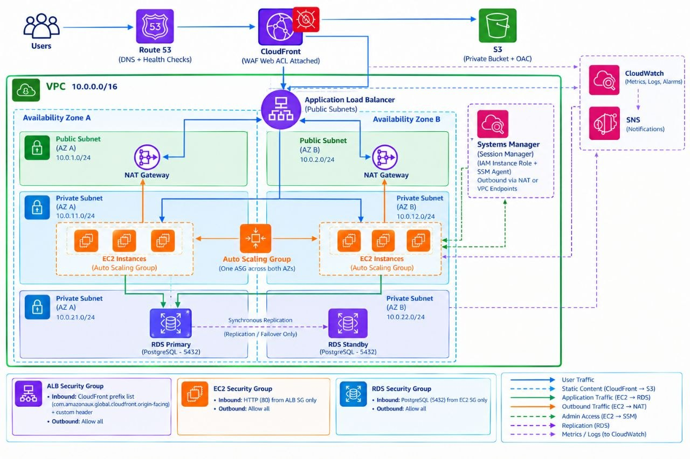

Scalable Web Application with ALB and Auto Scaling

AWS Solutions Architect – Associate Graduation Project

A secure, highly available, multi-tier web application architecture on AWS, designed around a public edge layer, a private compute tier, and a Multi-AZ data layer. The design spans two Availability Zones, separates public and private resources correctly, and removes direct SSH exposure to the internet in favor of IAM-based access.

---

Architecture Walkthrough

1. Edge layer — Route 53 → CloudFront (with WAF attached)

A request first resolves through Route 53 (DNS, with health checks so DNS can react to failures). It then hits CloudFront, which caches static assets at edge locations to cut latency for users far from the origin region. AWS WAF is attached to the CloudFront distribution as a Web ACL — it is not a separate network hop, but a set of rules CloudFront evaluates on every request before forwarding it to the origin (the ALB). This means malicious requests (SQL injection, XSS payloads, bad bots) are filtered out at the edge, before they ever reach the VPC.

2. Load balancing — Application Load Balancer

The ALB sits in the public subnets and is the single entry point into the VPC. It terminates Layer 7 traffic and distributes it across healthy EC2 targets in both Availability Zones, using target group health checks to automatically stop routing to an unhealthy instance.

3. Network design — VPC across two Availability Zones

The VPC (10.0.0.0/16) is split into:

- Public subnets (one per AZ) — host the ALB and the NAT Gateways. These are the only resources with a path to/from the internet.
- Private subnets (one per AZ) — host the EC2 application instances and the RDS database. Nothing in these subnets is directly internet-facing; outbound access (for patches, package installs, talking to SSM endpoints) goes through the NAT Gateway in the same AZ, and nothing can initiate a connection in from the internet.

Spreading both subnet types across two AZs is what makes the architecture highly available: the loss of a single AZ still leaves a working public subnet, private subnet, and database replica.

4. Compute — EC2 + Auto Scaling Group

Application servers run as a single Auto Scaling Group, with its instances distributed across the private subnets in both Availability Zones. The ASG adds or removes instances based on demand (target tracking), so the app scales out under load and scales in to save cost when idle, without manual intervention. Spanning both AZs means the ASG keeps the application available even if one AZ goes down.

5. Data layer — RDS (Multi-AZ, PostgreSQL)

The database is RDS for PostgreSQL in Multi-AZ mode: a primary instance in one AZ, synchronously replicated to a standby in the other. All EC2 instances in the Auto Scaling Group — regardless of which AZ they're in — connect to the same RDS primary endpoint on port 5432. The standby is never queried directly by the application; it exists purely so AWS can fail over automatically if the primary fails, re-pointing that same endpoint to the standby. This is the correct way to consume RDS Multi-AZ — the failover mechanism is designed around a single, stable connection endpoint for automatic recovery, not an app that reads application data from the standby directly.

6. Instance access — Systems Manager Session Manager (no bastion, no SSH)

Instead of a bastion/jump host with an open SSH port, administrative access to the EC2 instances goes through AWS Systems Manager Session Manager. This requires two things on every instance:

- An IAM instance role attached to the EC2 launch template, with the AmazonSSMManagedInstanceCore policy (or an equivalent scoped policy), so the SSM Agent running on the instance is authorized to register with Systems Manager.
- Outbound HTTPS (443) connectivity from the instance to the SSM service endpoints. In this design that path goes out through the NAT Gateway in the instance's AZ, the same path used for OS/package updates — no additional inbound rule is needed. (An alternative, more locked-down option is to use VPC Interface Endpoints for ssm, ssmmessages, and ec2messages instead of routing this traffic through the NAT Gateway; this design uses the NAT Gateway path since it's already provisioned for outbound updates.)

No inbound port is opened for SSH anywhere in this design — every session is authorized by IAM and logged in CloudTrail. This removes an entire class of attack surface (an exposed bastion host) that a traditional jump-host design would otherwise introduce.

7. Observability — CloudWatch + SNS

CloudWatch collects metrics, logs, and alarms across the ALB and EC2 fleet. When a threshold is crossed (e.g. unhealthy host count, high latency), CloudWatch triggers SNS to notify the team — so failures are surfaced automatically instead of being discovered by users first.

8. Storage — S3 (private bucket, accessed only via CloudFront)

Static assets and application files are stored in a private S3 bucket — public access is blocked entirely. CloudFront reaches the bucket using Origin Access Control (OAC), which lets the CloudFront distribution read objects while the bucket policy denies every other principal. End users never hit S3 directly; everything is served through CloudFront, keeping static content delivery off the application servers and off the public internet path entirely.

---

Key Design Decisions

Why Systems Manager Session Manager instead of a bastion/jump host?
A bastion host still means an open SSH port reachable from the internet (even if IP-restricted), plus one more instance to patch, monitor, and secure. Session Manager removes that attack surface entirely: no inbound port is ever opened for admin access, and every session is authenticated and authorized through IAM with a full audit trail in CloudTrail. This directly reflects the "bastion-free access alternative" called out as a learning outcome for this project track.

Why a single RDS endpoint instead of connecting to both Primary and Standby?
In RDS Multi-AZ, the application should only ever talk to the primary endpoint. The standby exists purely for synchronous replication and automatic failover — AWS re-points the same DNS endpoint to the standby if the primary fails. Having application servers connect to the standby directly would bypass how Multi-AZ failover is actually designed to work, and could read stale or inconsistent data outside of a real failover event.

Why attach WAF to CloudFront rather than only relying on security groups?
Security groups filter by IP/port — they can't inspect request content. WAF adds request-level filtering (SQL injection patterns, XSS payloads, rate-based rules) that a security group simply cannot express. Attaching the Web ACL to the CloudFront distribution (rather than the ALB) means filtering happens at the edge, as close to the attacker as possible, before the request ever travels into the AWS region hosting the VPC.

---

Key AWS Services

Layer	Service	Purpose

DNS & CDN	Route 53	DNS routing and health checks
	CloudFront	Caches static assets, reduces latency globally; Web ACL (WAF) attached here
Edge Security	AWS WAF	Filters traffic against OWASP Top 10 rules, attached to the CloudFront distribution
Compute	Application Load Balancer	Layer 7 routing across Availability Zones (sits in the public subnets)
	EC2 + Auto Scaling Group	One ASG spanning both private subnets, scaled by demand
Access	Systems Manager Session Manager	Secure, IAM-based instance access (no SSH), reached via NAT/SSM endpoints
Networking	VPC	Public subnets (ALB, NAT Gateways) + private subnets (EC2, RDS) across two AZs
Data	RDS for PostgreSQL (Multi-AZ)	Primary/standby database in the private subnets, with automatic failover
Storage	S3 (private, OAC)	Static assets and application files, served only through CloudFront
Observability	CloudWatch + SNS	Monitoring, dashboards, and alerts

---

Security Group Design

Security Group	Inbound	Outbound

ALB SG	HTTP/HTTPS (80/443), restricted to CloudFront traffic only — see below	Allow all
EC2 SG	HTTP (80) from ALB SG only — no SSH from the internet	Allow all (NAT, RDS, SSM endpoints)
RDS SG	PostgreSQL (5432) from EC2 SG only	Allow all

Each layer can only be reached from the layer directly in front of it — the database is unreachable from anywhere except the application tier, and the application tier is unreachable from anywhere except the load balancer.

Locking the ALB down to CloudFront only. Leaving the ALB open to 0.0.0.0/0 means someone could bypass CloudFront — and the WAF Web ACL attached to it — by hitting the ALB's DNS name directly. To close that gap, the ALB security group should only accept traffic from CloudFront's IP range, using the AWS-managed com.amazonaws.global.cloudfront.origin-facing prefix list (so the allowed ranges stay current automatically as AWS updates them). As defense in depth on top of that, CloudFront can be configured to add a custom header with a secret value to every request it forwards, and the ALB's listener rule can reject any request that doesn't carry it — so even a request from a spoofed CloudFront IP gets rejected.

---

Traffic Flow

1. Internet → Route 53 → CloudFront (WAF Web ACL evaluated here) → ALB
2. ALB → EC2 (HTTP 80) — load balanced across both Availability Zones, into one Auto Scaling Group
3. EC2 → RDS primary endpoint — every instance in the ASG, in either AZ, reads/writes through the same endpoint
4. RDS Primary → Standby — synchronous replication (AWS-managed, not app-facing)
5. EC2 ⇄ Session Manager — admin access via outbound SSM endpoints (through NAT), no inbound SSH required
6. CloudFront → S3 — static asset delivery

---

AWS Services Used

Route 53 · CloudFront (WAF, OAC) · AWS WAF · Application Load Balancer · EC2 · Auto Scaling · VPC (subnets, route tables, NAT Gateway) · RDS for PostgreSQL (Multi-AZ) · S3 (private) · Systems Manager (Session Manager) · CloudWatch · SNS · IAM

---

Learning Outcomes

- Designing a VPC with correct public/private subnet separation and routing
- Building highly available architectures across multiple Availability Zones
- Configuring ALB listener rules and target group health checks
- Implementing Auto Scaling with target tracking policies
- Replacing bastion-host SSH access with Systems Manager Session Manager
- Designing least-privilege security groups between network layers
- Understanding RDS Multi-AZ failover and why the application only ever talks to the primary endpoint
- Applying WAF as a request-level filtering layer at the CloudFront edge, in front of the load balancer
- Scoping an IAM instance role for SSM access, and understanding the network path (NAT Gateway vs. VPC interface endpoints) Session Manager traffic needs
- Locking an ALB down to accept traffic only from CloudFront (managed prefix list + custom header), so the WAF layer can't be bypassed
- Serving private S3 content securely through CloudFront using Origin Access Control (OAC)
